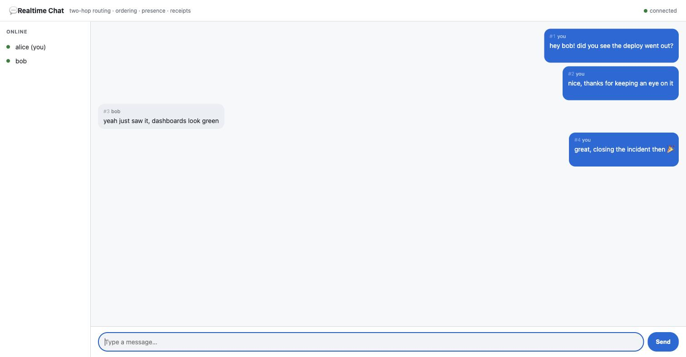

# Learn Realtime Delivery in TypeScript

A hands-on, runnable project for understanding realtime systems at a Staff/EM
level — how a chat/notification/live system actually pushes bytes to millions of
devices.

Every phase is a small script you can run and read. No build step: modern Node
runs the TypeScript directly.

> Built to match a Staff-level study path. The through-line: **realtime is two
> hops** — **routing** ("which gateway holds this user's connection?", a pub/sub
> problem) and **transport** ("how do bytes reach the device?", a
> connection-lifecycle problem). Everything else — presence, ordering, offline,
> fan-out — is bookkeeping around those two hops.

## Prerequisites

- **Node.js 22+** (uses native `.ts` execution)
- **Redis** on `localhost:6379` for Phases 2, 6 and the chat app
  ```bash
  # macOS:   brew install redis && brew services start redis
  # Docker:  docker run -d -p 6379:6379 redis
  ```

## Setup

```bash
npm install
```

## The lessons

Each prints a timestamped log so you can watch messages route, reorder, ack,
and sync.

| Command | What you learn | Maps to |
|---|---|---|
| `npm run phase1` | **Transports** — long-poll vs SSE vs WebSocket, and the decision rule | transport (hop 2) |
| `npm run phase2` | **The two-hop pattern** — user→gateway registry + Redis pub/sub routing | routing (hop 1) |
| `npm run phase3` | **Ordering** — per-conversation sequence IDs + a client reorder buffer | ordering |
| `npm run phase4` | **Delivery receipts** — the sent→delivered→read state machine; twice/out-of-order/never | receipts |
| `npm run phase5` | **Presence** — heartbeats, the fan-out monster, flap damping | presence |
| `npm run phase6` | **Offline sync** — fetch-since (not "replay the queue") + jittered reconnect | offline |
| `npm run phase7` | **Push notifications** — the online↔push race, dedup, collapse keys, token pruning | offline delivery |
| `npm run phase8` | **Group fan-out** — write vs read, the threshold hybrid, the celebrity problem | scaling groups |
| `npm run phase9` | **Backpressure** — one slow 2G client OOMs a node; bound the buffer, drop the consumer | flow control |
| `npm run phase10` | **The reconnect storm** — deploy 2M sockets: slow drain + jitter + headroom + cursor resume | recovery |
| `npm run phase11` | **C10M capacity** — memory-bound derivation, event loop vs thread-per-conn, failover headroom | scaling connections |
| `npm run phase12` | **E2E encryption** — X3DH + double ratchet (real `node:crypto`); the blind-relay architecture | encryption |

> **Phases 7–12 fold in the Staff-level seams** the module says interviews turn on — push,
> group fan-out at scale, the slow-consumer war story, the recovery storm, C10M capacity,
> and E2E. They're all dependency-free and deterministic (phase 12 uses only `node:crypto`),
> so unlike phases 2/6 and the chat app they need **no Redis**.

## Capstone: a live chat app

```bash
npm run chat        # gateway + UI on http://localhost:5200
```

Open it in **two or three browser tabs**, pick names, and chat. It ties every
phase together: WebSocket transport, Redis pub/sub routing, per-message sequence
ordering, delivery/read receipts, a live presence roster, and history sync on
join. Run a second gateway (`PORT=5201 npm run chat`) and the tabs still see
each other — that's hop 1 working across gateways.



## What each phase proves (the money quotes)

- **Phase 2** — alice on gateway-1 messages bob on gateway-3; the message hops
  the Redis bus to the right gateway, and an offline carol's message lands in her
  inbox for reconnect.
- **Phase 5** — a flapping user with 500 watchers costs **2500** notifications
  naively vs **500** with flap damping.
- **Phase 6** — a 10,000-client reconnect storm spread from one lethal instant to
  ~2,000/sec across 5s of jittered backoff.
- **Phase 8** — a 100k-member group on fan-out-on-write = **100k inbox writes** per
  message (~50k writes/sec for one busy group); the crossover to a shared log is at
  ~a few hundred members.
- **Phase 9** — an unbounded send buffer climbs `23→46→…→207 💥 OOM`; bound+drop holds
  node memory at **0/200** and the healthy connections are untouched.
- **Phase 10** — a naive deploy spikes **200k reconnects/tick** (6.7× over capacity);
  drain + jitter flattens it to a **~560/tick** plateau (2.1% of capacity).
- **Phase 12** — Alice and Bob derive the **same** shared secret via real X25519 while
  Bob is offline; stealing today's key can't decrypt past messages (forward secrecy).

## Interactive Realtime Lab

Every phase is also a live, **drawn** instrument in the browser — pick a workload and
read off the transport, watch a message hop the registry + backplane to the right
gateway, derive C10M node counts, scramble ordering with client clocks, cross the
group-fan-out threshold, collapse push notifications, ratchet an E2E key, and flatten
a reconnect storm.

```bash
npm run web        # serves web/index.html at http://localhost:8080 (no deps)
```

One self-contained static page (SVG visuals, self-hosted fonts), grouped by tier and
deep-linkable. To host it on **Cloudflare Pages**: connect this repo in the dashboard
with build output `web` (auto-deploys on push), or run `npx wrangler login` then
`npm run deploy`.

## Project layout

```
src/
  lib/log.ts              shared timestamped logger
  phase1/  transports (long-poll / SSE / WebSocket)
  phase2/  two-hop routing (registry + Redis pub/sub)
  phase3/  per-conversation ordering + reorder buffer
  phase4/  delivery-receipt state machine
  phase5/  presence + flap damping
  phase6/  offline sync + reconnect storms
  phase7/  push notifications (online↔push race, collapse, token pruning)
  phase8/  group fan-out — write vs read threshold
  phase9/  backpressure — slow consumer, bound + drop
  phase10/ connection draining + the reconnect storm
  phase11/ C10M capacity derivation
  phase12/ E2E encryption (X3DH + double ratchet, node:crypto)
  app/     the live chat gateway + browser UI
web/
  index.html  ·  serve.mjs   (the interactive Realtime Lab — npm run web)
```

## Drill & study guide

The web lab has a **Drill** tab — the matching study module's interview questions
and cheat-sheet one-liners as click-to-reveal cards (active recall: answer out
loud before revealing). [`STUDY-GUIDE.md`](STUDY-GUIDE.md) maps every phase to
the exact module section it implements, with the staff-level insight quoted, and
points to the deep dives to read next.

## License

MIT — use it, fork it, learn from it.
